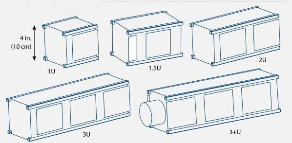
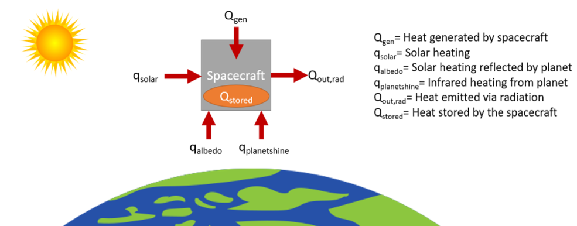
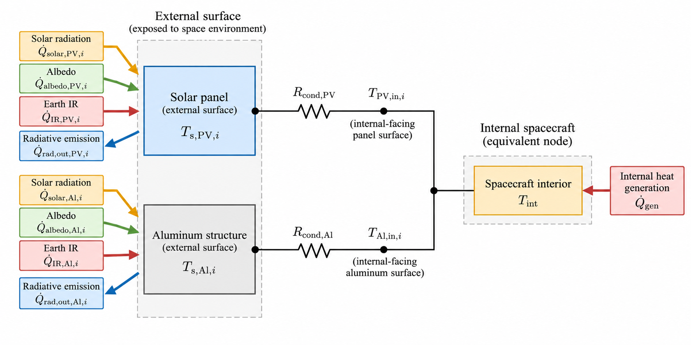

# Preliminary Thermal Analysis of a 2U CubeSat
## Reduced-order, one-dimensional, steady-state model

**Author:** Alexander Fomin

**Team**: Málaga Space Team

**Status:** Preliminary engineering model.

**Scope:** External aluminum and photovoltaic temperatures, with one equivalent internal spacecraft temperature, for an idealized sunlight case and an eclipse case. The internal heat load is held at **1.5 W in both** cases to represent the nominal electrical consumption averaged over an orbit.  

---

## 1. Objective and analysis cases

The objective is to estimate internal temperatures for a nominal **2U CubeSat operating in low Earth orbit (LEO)** and to identify major thermal-design sensitivities before a detailed mechanical model, numerical thermal analysis, and thermal testing are available.

The main objective is to estimate:

- $T_{\mathrm{int}}$: spacecraft internal temperature;
- $T_{s,\mathrm{Al},i}$: external aluminum temperature for each of the six faces;
- $T_{s,\mathrm{PV},i}$: external photovoltaic temperature for each of the four lateral faces;
- The balance between incident heating, electronic power dissipation, and thermal radiation.

Two distinct **boundary-condition cases** are considered:

- **Case A — Idealized direct sunlight configuration:** a specified face points directly at the Sun ($c_i=1$ for that face), with a specified nadir direction.
- **Case B — Eclipse:** no direct solar illumination or sunlit-Earth albedo; Earth infrared illumination and thermal emission remain active.

Both cases are stationary and we have to consider that in reality, the spacecraft periodically entering sunlight and eclipse may never attain either equilibrium.

### 1.1 Core assumptions

- The satellite is in a circular LEO, using a **500 km altitude** for preliminary parameters.
- The exterior is exposed to vacuum; external convection is neglected.
- Each modeled surface region is isothermal and represented by one external thermal node.
- There is **one common equivalent internal temperature** $T_{\mathrm{int}}$.
- Heat conduction in each branch is idealized as **one-dimensional, perpendicular to the local surface**.
- No lateral heat spreading between aluminum and PV regions, no separate PV mounting-point conduction, and no interior rear-side radiation exchange are explicitly represented.
- For the baseline model, each interior-facing wall/panel temperature is **approximated by** $T_{\mathrm{int}}$.
- External surfaces are approximated as diffuse/gray in the infrared; thermal radiation properties are constant in each run.
- Direct solar absorption uses solar absorptivity $\alpha$, distinct from infrared emissivity $\varepsilon$.
- The Earth infrared field is prescribed using a reference outgoing longwave flux and a face-dependent Earth view factor.
- Mutual radiation between spacecraft exterior surfaces and self-shadowing are neglected.
- Deep-space background irradiation is negligible compared with spacecraft emission; it could be restored if necessary.
- Solar-array electrical power extraction is treated separately from internal electronic heat generation.
- The spacecraft consumes an **estimated 1.5 W of electrical power on average over an orbit**. The thermal baseline assumes **constant** internal dissipation of **1.5 W** during both the sunlight and eclipse equilibrium cases; transient consumption peaks and troughs are intentionally outside scope.

---

## 2. Constants, variables, and preliminary numerical parameters

### 2.1 Reference environment

| Symbol | Description | Preliminary value | Units |
|:--|:--|--:|:--|
| $G_{\mathrm{solar}}$ | Direct solar irradiance | 1361 | W/m² |
| $G_{\mathrm{IR}}$ | Reference Earth outgoing infrared flux used with $F_{i\to E}$ | 237 | W/m² |
| $a_E$ | Effective Earth albedo coefficient | 0.30 | – |
| $\sigma$ | Stefan–Boltzmann constant | $5.670374419\times 10^{-8}$ | W/(m²·K⁴) |
| $h$ | Nominal orbit altitude | 500 | km |
| $R_E$ | Mean Earth radius | 6371 | km |
| $T_{\mathrm{space}}$ | Deep-space equivalent background temperature | neglected in baseline | K |

**Interpretation:** The chosen $G_{\mathrm{solar}}$, $G_{\mathrm{IR}}$, and $a_E$ are **preliminary reference values**. They vary with orbital, seasonal, geographic, cloud, and solar conditions.

### 2.2 Material and electrical properties

| Symbol | Description | Preliminary value | Units |
|:--|:--|--:|:--|
| $k_{\mathrm{Al}}$ | Aluminum thermal conductivity | 167 | W/(m·K) |
| $L_{\mathrm{Al}}$ | Nominal aluminum wall thickness | 0.002 | m |
| $\alpha_{\mathrm{Al}}$ | Aluminum solar absorptivity | 0.35 | – |
| $\varepsilon_{\mathrm{Al}}$ | Aluminum infrared emissivity | 0.10 | – |
| $\alpha_{\mathrm{PV}}$ | PV-region solar absorptivity | 0.90 | – |
| $\varepsilon_{\mathrm{PV}}$ | PV-region infrared emissivity | 0.85 | – |
| $\eta_{\mathrm{PV}}$ | Approximate cell conversion efficiency **when electrically operating near the relevant power point** | 0.29 | – |
| $L_{\mathrm{PV}}$ | Effective PV stack thickness | **to be verified** | m |
| $k_{\mathrm{PV}}$ | Effective through-thickness PV stack conductivity | **not specified** | W/(m·K) |
| $P_{\mathrm{cons,avg}}$ | Estimated electrical consumption averaged over one orbit | 1.5 | W |
| $\dot Q_{\mathrm{gen}}$ | Assumed *constant* internal thermal dissipation, used in both cases | 1.5 | W |

**Notes on these values:**

- Aluminum optical properties depend strongly on **surface finish, anodization/coating, contamination, and aging**.
- Solar-cell optical properties are properties of the actual **coverglass/cell/interconnect assembly**, not only the semiconductor material. Later on we must validate the assumed $\alpha_{\mathrm{PV}}$ and $\varepsilon_{\mathrm{PV}}$.
- The manufacturer's **3G30A-Advanced (4×8)** assembly reference gives a nominal assembly thickness of approximately **290 μm**, but the actual panel construction may add adhesives, encapsulation, wiring and mechanical support.
- **1.5 W is the estimated mean electrical power consumption over an entire orbit** (not 1.5 Wh per orbit), for the **entire spacecraft**. For this model, that orbit-average is applied as **constant 1.5 W internally dissipated heat in both sunlight and eclipse**.

### 2.3 Geometric, illumination, and temperature variables

| Symbol | Meaning | Units |
|:--|:--|:--|
| $a$ | Spacecraft cross-section width | m |
| $L$ | Spacecraft length | m |
| $A_L$ | Area of one lateral face | m² |
| $A_E$ | Area of one end face | m² |
| $A_{\mathrm{cell,env}}$ | Envelope/outer rectangle area of one PV assembly | m² |
| $A_{\mathrm{PV}}$ | Effective exposed PV-region area per lateral face in the simplified thermal model | m² |
| $A_{\mathrm{act}}$ | Total electrically active PV cell area per lateral face | m² |
| $A_{\mathrm{Al}}$ | Exposed aluminum area per lateral face | m² |
| $\mathbf n_i$ | Unit outward normal of face $i$ | – |
| $\mathbf s$ | Unit vector from spacecraft toward Sun | – |
| $\theta_i$ | Angle between outward face normal and Sun direction | rad or ° |
| $c_i$ | Solar-incidence factor, including eclipse state | – |
| $b_i$ | Effective albedo illumination/geometry factor | – |
| $F_{i\to E}$ | Earth view factor of face $i$ | – |
| $F_{i\to S}$ | Space view factor of face $i$ | – |
| $T_{s,\mathrm{Al},i}$ | External aluminum surface temperature | K |
| $T_{s,\mathrm{PV},i}$ | External PV surface temperature | K |
| $T_{\mathrm{int}}$ | Equivalent internal spacecraft temperature | K |
| $R_{\mathrm{cond},j}$ | Through-thickness conduction thermal resistance of branch $j$ | K/W |
| $P_{\mathrm{el,PV},i}$ | Electrical power actually extracted from PV region on face $i$ | W |

---

## 3. Simplified 2U geometry

The preliminary spacecraft envelope is **100 × 100 × 227 mm**, as per the Cal Poly-listed dimensions for a 2U CubeSat.

### 3.1 Six external faces

Set:

$$
a=0.100\ \mathrm{m},\qquad L=0.227\ \mathrm{m}.
$$

One lateral face:

$$
\boxed{A_L=aL=0.100(0.227)=0.0227\ \mathrm{m^2}}
$$

One square end (top/bottom) face:

$$
\boxed{A_E=a^2=0.0100\ \mathrm{m^2}}
$$

Complete exterior surface:

$$
\boxed{A_{\mathrm{total}}=4A_L+2A_E=0.1108\ \mathrm{m^2}}
$$

### 3.2 Photovoltaic assembly coverage

There are **four AZUR SPACE 3G30A-Advanced (4×8) solar panels per lateral face**, totaling **16 units** on the four lateral faces.

Manufacturer-listed **outer dimensions** for the reference assembly:

$$
40.15\times80.15\ \mathrm{mm}.
$$

Surface area of one assembly:

$$
A_{\mathrm{cell,env}}
=0.04015(0.08015)
=0.0032180225\ \mathrm{m^2}.
$$

Four-assembly surface area per lateral face:

$$
\boxed{A_{\mathrm{PV}}\approx4A_{\mathrm{cell,env}}=0.01287209\ \mathrm{m^2}}
$$

In this **preliminary** geometric approximation, the remainder of the face is aluminum:

$$
\boxed{A_{\mathrm{Al}}=A_L-A_{\mathrm{PV}}=0.00982791\ \mathrm{m^2}}
$$

Coverage of a lateral face:

$$
\frac{A_{\mathrm{PV}}}{A_L}\times100\approx56.7\%,
\qquad
\frac{A_{\mathrm{Al}}}{A_L}\times100\approx43.3\%.
$$

**Important area distinction:** The AZUR SPACE reference specifies an electrically active **bare-cell area of 30.18 cm²** and a **glassed area of 31.13 cm²** per assembly. Neither equals the complete rectangular outer envelope area (approximately 32.18 cm²). Therefore:

$$
\boxed{A_{\mathrm{act}}=4(30.18\times10^{-4})=0.012072\ \mathrm{m^2}\quad\text{per lateral face}}
$$

Here, $A_{\mathrm{PV}}$ denotes the **outer-envelope thermal coverage approximation**, whereas $A_{\mathrm{act}}$ denotes the **actual active cell area** for electricity.

---

## 4. Overall spacecraft energy balance

### 4.1 General conservation law

The spacecraft exchanges energy by direct solar radiation, Earth albedo, Earth infrared radiation, internally dissipated power, and emitted infrared radiation. We also account explicitly for **electrical energy removed from PV surface heat balances**.

For the present thermal control volume:

$$
\boxed{
\dot Q_{\mathrm{solar}}
+\dot Q_{\mathrm{albedo}}
+\dot Q_{\mathrm{IR}}
+\dot Q_{\mathrm{gen}}
-P_{\mathrm{el}}
=
\dot Q_{\mathrm{stored,thermal}}
+\dot Q_{\mathrm{rad,out}}
}
$$

where each external absorbed-radiation term is a **total thermal power** in W and $P_{\mathrm{el}}=\sum_{i\in\mathcal L}P_{\mathrm{el,PV},i}$ is the PV electricity extracted from the surface control volumes.

For idealized steady-state temperatures:

$$
\frac{dT}{dt}=0,
\qquad
\dot Q_{\mathrm{stored,thermal}}=0.
$$

Thus:

$$
\boxed{
\dot Q_{\mathrm{solar}}
+\dot Q_{\mathrm{albedo}}
+\dot Q_{\mathrm{IR}}
+\dot Q_{\mathrm{gen}}
-P_{\mathrm{el}}
=
\dot Q_{\mathrm{rad,out}}
}
$$

Alternatively, if Earth IR is included in **net** emitted radiation:

$$
\dot Q_{\mathrm{rad,net}}=\dot Q_{\mathrm{rad,out}}-\dot Q_{\mathrm{IR}},
$$

then:

$$
\boxed{
\dot Q_{\mathrm{solar}}+\dot Q_{\mathrm{albedo}}
+\dot Q_{\mathrm{gen}}-P_{\mathrm{el}}
=\dot Q_{\mathrm{rad,net}}
}
$$

Absorbed Earth IR appears as an **input** and the emitted thermal radiation by the satellite is calculated separately. We do this because Earth IR is active in all scenarios.

### 4.2 Orbit-averaged consumption, constant thermal dissipation, and PV generation

The expected **nominal electrical consumption averaged over one spacecraft orbit** is:

$$
\boxed{P_{\mathrm{cons,avg}}=1.5\ \mathrm{W}}
$$

This is our expected "maximum" **average power**, that we had obtained through another power generation analysis using a simulator. It is not a measurement of instantaneous power and is not necessarily equal to electrical power produced by the solar array at a particular point along the orbit.

So, the electrical power consumed by the satellite, ultimately becomes heat, so we use this value as a constant (for now):

$$
\boxed{\dot Q_{\mathrm{gen}}\approx P_{\mathrm{cons,avg}}=1.5\ \mathrm{W}}
$$

The electrical power extracted from the photovoltaic cells depends on incident solar radiation, active cell area, and conversion efficiency. For each lateral face $i$, it is estimated as:

$$P_{\mathrm{el,PV},i} = \eta_{\mathrm{PV}} \cdot G_{\mathrm{solar}} \cdot A_{\mathrm{act}} \cdot c_i$$

where:

- $P_{\mathrm{el,PV},i}$ — Electrical power extracted from the photovoltaic cells on face $i$ [W].
- $\eta_{\mathrm{PV}}$ — Assumed photovoltaic conversion efficiency, equal to 0.29 [-].
- $G_{\mathrm{solar}}$ — Incident solar irradiance [W/m²].
- $A_{\mathrm{act}}$ — Total active photovoltaic area per lateral face [m²].
- $c_i$ — Solar incidence factor for face $i$ [-].

For a lateral face under normal solar incidence ($c_i=1$):

$$
P_{\mathrm{el,PV},i}
= 0.29(1361)(0.012072)
\approx 4.76\ \mathrm{W}
$$

This calculation assumes photovoltaic operation near the maximum power point. The extracted electrical power is subtracted from the photovoltaic surface energy balance, while the CubeSat's nominal internal heat dissipation is modeled separately as a constant $Q_{\mathrm{gen}}=1.5\ \mathrm{W}$.

During eclipse, direct solar electrical generation is zero, so $P_{\mathrm{el,PV},i}=0$, while the assumed internal heat dissipation remains constant.

---

## 5. External radiation model

The three external radiation inputs are:

1. Direct solar radiation (shortwave).
2. Earth-reflected solar radiation, or albedo (shortwave).
3. Earth-emitted infrared radiation (longwave).

Solar absorptivity $\alpha$ is used for the two **shortwave** sources; longwave absorptivity is approximated by infrared emissivity $\varepsilon$ for the assumed diffuse-gray material.

### 5.1 Direct solar absorption

Define a sunlight indicator $\chi$:

$$
\chi=
\begin{cases}
1,&\text{sunlight},\\
0,&\text{eclipse}.
\end{cases}
$$

For face $i$, the direct solar incidence factor is (Lambert's cosine Law):

$$
\boxed{c_i=\chi\max\!\left(0,\mathbf n_i\cdot\mathbf s\right)}
$$

where $\mathbf n_i$ is the outward unit face normal and $\mathbf s$ points from the satellite toward the Sun. Consequently, $c_i=1$ at normal incidence and $c_i=0$ at grazing incidence, on a face pointing away from the Sun, or during eclipse.

For region $m$ on face $i$:

$$
\boxed{\dot Q_{\mathrm{solar},m,i}=G_{\mathrm{solar}}\alpha_m A_{m,i}c_i}
$$

Lateral face regions:

$$
\dot Q_{\mathrm{solar,Al},i}=G_{\mathrm{solar}}\alpha_{\mathrm{Al}}A_{\mathrm{Al}}c_i,
$$

$$
\dot Q_{\mathrm{solar,PV},i}=G_{\mathrm{solar}}\alpha_{\mathrm{PV}}A_{\mathrm{PV}}c_i.
$$

For an end (top/bottom) face, replace $A_{\mathrm{Al}}$ by $A_E$.

### 5.2 Electrical power removed at PV regions

The first-order estimate for *actual extracted* PV power is:

$$
\boxed{
P_{\mathrm{el,PV},i}
=\eta_{\mathrm{oper},i}G_{\mathrm{solar}}A_{\mathrm{act}}c_i
}
$$

where $\eta_{\mathrm{oper},i}$ is the **effective operating-point efficiency**, which may be lower than the nominal maximum-power efficiency $\eta_{\mathrm{PV}}$. As a first approximation, one can use $\eta_{\mathrm{oper},i}=0.29$ **only** for a stated, electrically justified near-MPP operating case.

The *direct-solar thermal power deposited in the PV region*, prior to other radiation inputs and conduction, is:

$$
\boxed{
\dot Q_{\mathrm{solar,PV,th},i}
=G_{\mathrm{solar}}\alpha_{\mathrm{PV}}A_{\mathrm{PV}}c_i
-P_{\mathrm{el,PV},i}
}
$$

Ensure $0\le P_{\mathrm{el,PV},i}\le G_{\mathrm{solar}}\alpha_{\mathrm{PV}}A_{\mathrm{PV}}c_i$ in this simplified calculation.

### 5.3 Earth albedo

Earth albedo is sunlight reflected by **the illuminated Earth/atmosphere**:

$$
\boxed{
\dot Q_{\mathrm{albedo},m,i}
=G_{\mathrm{solar}}a_E b_i\alpha_m A_{m,i}
}
$$

where:

- $a_E$ is the albedo coefficient;
- $b_i$ is a **face-dependent illumination and geometry factor** that incorporates visibility of illuminated Earth.

**This doesn't mean $b_i=F_{i\to E}$ automatically.** A face may see Earth without seeing much of its sunlit portion. In full eclipse, $b_i=0$. For the sunlight case, $b_i$ must be calculated from an orbit/attitude-specific approximation.

For a lateral face:

$$
\dot Q_{\mathrm{albedo,Al},i}
=G_{\mathrm{solar}}a_Eb_i\alpha_{\mathrm{Al}}A_{\mathrm{Al}},
$$

$$
\dot Q_{\mathrm{albedo,PV},i}
=G_{\mathrm{solar}}a_Eb_i\alpha_{\mathrm{PV}}A_{\mathrm{PV}}.
$$

The PV power-extraction formula above is based on **direct solar radiation**. Any conversion of diffuse Earth-albedo irradiance to electricity is **neglected** as a small preliminary simplification; it can be included later if relevant to the EPS operating state.

### 5.4 Earth infrared absorption

Unlike direct sunlight and albedo, Earth IR is present **also during orbital eclipse**. Using an approximately diffuse Earth longwave radiation field:

$$
\boxed{
\dot Q_{\mathrm{IR},m,i}
=G_{\mathrm{IR}}F_{i\to E}\varepsilon_m A_{m,i}
}
$$

where $F_{i\to E}$ is the Earth view factor for the specified face, orbit, and attitude. This uses the assumed longwave Kirchhoff approximation $\alpha_{\mathrm{IR},m}\approx\varepsilon_m$.

For a lateral face:

$$
\dot Q_{\mathrm{IR,Al},i}
=G_{\mathrm{IR}}F_{i\to E}\varepsilon_{\mathrm{Al}}A_{\mathrm{Al}},
$$

$$
\dot Q_{\mathrm{IR,PV},i}
=G_{\mathrm{IR}}F_{i\to E}\varepsilon_{\mathrm{PV}}A_{\mathrm{PV}}.
$$

For an end face:

$$
\dot Q_{\mathrm{IR,Al},i}
=G_{\mathrm{IR}}F_{i\to E}\varepsilon_{\mathrm{Al}}A_E.
$$

The simplified Earth view-factor relation for an unobstructed exterior is:

$$
F_{i\to E}+F_{i\to S}=1.
$$

For example, for an ideal plane facing **exactly toward Earth's center (nadir)**, assuming a uniformly radiating spherical Earth at altitude $h$:

$$
F_{\mathrm{nadir}\to E}\approx
\left(\frac{R_E}{R_E+h}\right)^2
\approx0.86\quad(h=500\ \mathrm{km}).
$$

A zenith-facing plane in this simple geometry has $F_{\mathrm{zenith}\to E}=0$. The Earth view factors of side faces require their appropriate calculations.

### 5.5 Emitted radiation and net infrared exchange

For an exterior surface region $m,i$, the **outgoing** thermal radiation is:

$$
\boxed{
\dot Q_{\mathrm{rad,out},m,i}
=\varepsilon_m\sigma A_{m,i}T_{s,m,i}^{4}
}
$$

Deep-space radiation is neglected.

---

## 6. One-dimensional conduction model

### 6.1 Sign convention

We define the branch conductive power $\dot Q_{\mathrm{cond},m,i}$ to be **positive from the spacecraft interior toward the external surface**:

$$
\boxed{
\dot Q_{\mathrm{cond},m,i}
=\frac{T_{\mathrm{int}}-T_{s,m,i}}
{R_{\mathrm{cond},m,i}}
}
$$

It becomes **negative** when the exterior is hotter and transfers heat inward.

### 6.2 Aluminum conduction

For each exposed lateral aluminum region:

$$
\boxed{
R_{\mathrm{cond,Al},i}
=\frac{L_{\mathrm{Al}}}
{k_{\mathrm{Al}}A_{\mathrm{Al}}}
}
\qquad(i\in\mathcal L).
$$

For each full aluminum end face:

$$
\boxed{
R_{\mathrm{cond,Al},i}
=\frac{L_{\mathrm{Al}}}
{k_{\mathrm{Al}}A_E}
}
\qquad(i\in\mathcal E).
$$

In the baseline, these represent **only wall-through-thickness resistance**. They do not account for board standoffs, electronic-package contacts, adhesive thermal interfaces, long in-plane conduction distances, or structural coupling.

For example, the nominal lateral wall resistance is:

$$
R_{\mathrm{cond,Al,lateral}}
\approx\frac{0.002}{167(0.00982791)}
\approx0.00122\ \mathrm{K/W}.
$$

### 6.3 Photovoltaic through-thickness conduction

The PV assemblies are placed **within openings in the aluminum faces and have no aluminum backing plate**. No lateral conduction from the PV to the aluminum, through edge mounts or through attachment points, is included (remain in 1D model).

For a homogeneous equivalent PV stack:

$$
\boxed{
R_{\mathrm{cond,PV},i}
=\frac{L_{\mathrm{PV}}}
{k_{\mathrm{PV}}A_{\mathrm{PV}}}
}
$$

If the assembly is modeled as layers that share the same effective cross-sectional area:

$$
\boxed{
R_{\mathrm{cond,PV},i}
=\sum_{n=1}^{N}
\frac{L_n}{k_nA_{\mathrm{PV}}}
}
$$

Since real laminated stacks can include important adhesive/interface thermal resistance (we won't be considering them here). 

**Chosen preliminary boundary condition:**

$$
\boxed{T_{\mathrm{PV,in},i}\approx T_{\mathrm{int}}}
$$

Therefore, in the baseline model:

$$
\boxed{
\dot Q_{\mathrm{cond,PV},i}
=\frac{T_{\mathrm{int}}-T_{s,\mathrm{PV},i}}
{R_{\mathrm{cond,PV},i}}
}
$$

---

## 7. Surface energy balances

Let $\mathcal L=\{+X,-X,+Y,-Y\}$ be the set of four lateral faces and $\mathcal E=\{+Z,-Z\}$ the two square end faces. These labels are geometric conventions; their assignment to Sun and nadir directions is specified separately in each case.

Every surface balance obeys:

$$
\boxed{
\dot Q_{\mathrm{solar}}
+\dot Q_{\mathrm{albedo}}
+\dot Q_{\mathrm{IR}}
+\dot Q_{\mathrm{cond}}
-P_{\mathrm{el,PV}}
=\dot Q_{\mathrm{rad,out}}
}
$$

For aluminum, $P_{\mathrm{el,PV}}=0$. In the PV equation, the conduction sign is **positive from interior to exterior**, as defined in Section 6.1.

### 7.1 Aluminum region on each lateral face

For $i\in\mathcal L$:

$$
\boxed{
\dot Q_{\mathrm{solar,Al},i}
+\dot Q_{\mathrm{albedo,Al},i}
+\dot Q_{\mathrm{IR,Al},i}
+\dot Q_{\mathrm{cond,Al},i}
=\dot Q_{\mathrm{rad,out,Al},i}
}
$$

Substituting:

$$
G_{\mathrm{solar}}\alpha_{\mathrm{Al}}A_{\mathrm{Al}}(c_i+a_Eb_i)
+
G_{\mathrm{IR}}F_{iE}\varepsilon_{\mathrm{Al}}A_{\mathrm{Al}}
+
\frac{T_{\mathrm{int}}-T_{s,\mathrm{Al},i}}{R_{\mathrm{cond,Al},i}}
=
\varepsilon_{\mathrm{Al}}\sigma A_{\mathrm{Al}}T_{s,\mathrm{Al},i}^{4}
$$

where:

- $G_{\mathrm{solar}}$ — Incident solar irradiance [W/m²].
- $\alpha_{\mathrm{Al}}$ — Aluminum solar absorptivity [–].
- $A_{\mathrm{Al}}$ — Exposed aluminum area per lateral face [m²].
- $c_i$ — Direct solar incidence factor [–].
- $a_E$ — Effective Earth albedo coefficient [–].
- $b_i$ — Illuminated-Earth albedo factor [–].
- $G_{\mathrm{IR}}$ — Reference Earth infrared flux [W/m²].
- $F_{i\to E}$ — Earth view factor [–].
- $\varepsilon_{\mathrm{Al}}$ — Aluminum infrared emissivity [–].
- $T_{\mathrm{int}}$ — Equivalent internal temperature [K].
- $T_{s,\mathrm{Al},i}$ — Exterior aluminum-region temperature [K].
- $R_{\mathrm{cond,Al},i}$ — Aluminum-wall conduction resistance [K/W].
- $\sigma$ — Stefan–Boltzmann constant [W/(m²·K⁴)].

### 7.2 Photovoltaic region on each lateral face

For $i\in\mathcal L$:

$$
\boxed{
\dot Q_{\mathrm{solar,PV},i}
+\dot Q_{\mathrm{albedo,PV},i}
+\dot Q_{\mathrm{IR,PV},i}
-P_{\mathrm{el,PV},i}
+\dot Q_{\mathrm{cond,PV},i}
=\dot Q_{\mathrm{rad,out,PV},i}
}
$$

Substituting and using the chosen $T_{\mathrm{PV,in},i}\approx T_{\mathrm{int}}$ condition:

$$
G_{\mathrm{solar}}\alpha_{\mathrm{PV}}A_{\mathrm{PV}}(c_i+a_Eb_i)
+
G_{\mathrm{IR}}F_{iE}\varepsilon_{\mathrm{PV}}A_{\mathrm{PV}}
-
P_{\mathrm{el,PV},i}
+
\frac{T_{\mathrm{int}}-T_{s,\mathrm{PV},i}}{R_{\mathrm{cond,PV},i}}
=
\varepsilon_{\mathrm{PV}}\sigma A_{\mathrm{PV}}T_{s,\mathrm{PV},i}^{4}
$$

where:

- $\alpha_{\mathrm{PV}}$ — PV surface solar absorptivity [–].
- $A_{\mathrm{PV}}$ — Effective exposed PV thermal area per lateral face [m²].
- $\varepsilon_{\mathrm{PV}}$ — PV surface longwave emissivity [–].
- $T_{s,\mathrm{PV},i}$ — Exterior photovoltaic temperature [K].
- $R_{\mathrm{cond,PV},i}$ — Through-thickness PV assembly conduction resistance [K/W].
- $P_{\mathrm{el,PV},i}$ — **Actual** electrical power extracted from face $i$ [W].
- The rest quantities were defined in Section 7.1.

Because their optical properties and thermal paths differ, **the PV and aluminum external temperatures are not equal**.

### 7.3 Two full aluminum end faces

For $i\in\mathcal E$, with area $A_E$:

$$
\boxed{
\dot Q_{\mathrm{solar,Al},i}
+\dot Q_{\mathrm{albedo,Al},i}
+\dot Q_{\mathrm{IR,Al},i}
+\dot Q_{\mathrm{cond,Al},i}
=\dot Q_{\mathrm{rad,out,Al},i}
}
$$

Substituting:

$$
G_{\mathrm{solar}}\alpha_{\mathrm{Al}}A_E(c_i+a_Eb_i)
+
G_{\mathrm{IR}}F_{iE}\varepsilon_{\mathrm{Al}}A_E
+
\frac{T_{\mathrm{int}}-T_{s,\mathrm{Al},i}}{R_{\mathrm{cond,Al},i}}
=
\varepsilon_{\mathrm{Al}}\sigma A_E T_{s,\mathrm{Al},i}^{4}
$$

Here $A_E$ is the area of **one** end face [m²], $T_{s,\mathrm{Al},i}$ is its outside temperature [K], and $R_{\mathrm{cond,Al},i}=L_{\mathrm{Al}}/(k_{\mathrm{Al}}A_E)$ [K/W]. All other symbols have the same meaning as above. The end faces are assumed to have no PV cells or additional exposed materials.

---

## 8. Satellite interior balance

The estimated CubeSat orbit-averaged electrical consumption is **1.5 W**. Assuming consumed power ultimately becomes internal heat, the **constant baseline heat load for both simulated cases** is:

$$
\boxed{\dot Q_{\mathrm{gen}}=P_{\mathrm{cons,avg}}=1.5\ \mathrm{W}}
$$

This value is applied **once to the internal node**, not once per component, lateral face, or orbital phase.

Under stationary conditions, the heat created at the interior node is balanced by **signed** conductive heat transfer into all external branches:

$$
\dot Q_{\mathrm{gen}}
=\sum_{i\in\mathcal L}\left(
\dot Q_{\mathrm{cond,Al},i}
+\dot Q_{\mathrm{cond,PV},i}
\right)
+\sum_{i\in\mathcal E}\dot Q_{\mathrm{cond,Al},i}
$$

Substituting:

$$
\dot Q_{\mathrm{gen}}
=
\sum_{i\in\mathcal{L}}
\left(
\frac{T_{\mathrm{int}}-T_{s,\mathrm{Al},i}}{R_{\mathrm{cond,Al},i}}
+
\frac{T_{\mathrm{int}}-T_{s,\mathrm{PV},i}}{R_{\mathrm{cond,PV},i}}
\right)
+
\sum_{i\in\mathcal{E}}
\frac{T_{\mathrm{int}}-T_{s,\mathrm{Al},i}}{R_{\mathrm{cond,Al},i}}
$$

**Interpretation:** A negative term would mean that a hotter exterior branch transfers heat **into** the interior of the satellite. 

---

## 9. Case A — Direct Solar Exposure

This case illustrates maximum **direct normal illumination of one selected lateral face**, not a proven spacecraft maximum-temperature scenario.

Body-frame orientation:

- $+X$ is a **lateral face** pointing toward the Sun.
- $+Y$ is a different **lateral face** pointing toward Earth (nadir).
- $+Z$ and $-Z$ are the two square **end faces**.
- The corresponding opposite faces point along $-X$ and $-Y$.

For this particular Sun/nadir geometry:

$$
\mathbf s=\hat{\mathbf x},
\quad
c_{+X}=1,
\quad
c_{-X}=c_{+Y}=c_{-Y}=c_{+Z}=c_{-Z}=0.
$$

**Note:** With Sun at $+X$ and nadir at $+Y$, the Sun and nadir directions are orthogonal.

For every face $i$ we need to:

1. Obtain a consistent Earth view factor $F_{i\to E}$.
2. Obtain a consistent albedo factor $b_i$ for the visible **sunlit** portion of Earth.
3. Specify $P_{\mathrm{el,PV},i}$ . Direct-solar electrical extraction vanishes on faces with $c_i=0$ in this approximation.
4. Solve the 11 steady-state equations in Sections 7 and 8.

For the directly illuminated $+X$ PV region, for example:

$$
G_{\mathrm{solar}}\alpha_{\mathrm{PV}}A_{\mathrm{PV}}(1+a_Eb_{+X})
+
G_{\mathrm{IR}}F_{+X\to E}\varepsilon_{\mathrm{PV}}A_{\mathrm{PV}}
-
P_{\mathrm{el,PV},+X}
+
\frac{T_{\mathrm{int}}-T_{s,\mathrm{PV},+X}}{R_{\mathrm{cond,PV},+X}}
=
\varepsilon_{\mathrm{PV}}\sigma A_{\mathrm{PV}}T_{s,\mathrm{PV},+X}^{4}
$$

---

## 10. Case B — Eclipse

Set the Sun indicator $\chi=0$, so for all faces:

$$
c_i=0,\qquad b_i=0,\qquad P_{\mathrm{el,PV},i}=0
$$

Earth infrared input remains:

$$
\dot Q_{\mathrm{IR},m,i}=G_{\mathrm{IR}}F_{i\to E}\varepsilon_m A_{m,i}
$$

Each lateral aluminum surface satisfies:

$$
G_{\mathrm{IR}}F_{i\to E}\varepsilon_{\mathrm{Al}}A_{\mathrm{Al}}
+
\frac{T_{\mathrm{int}}-T_{s,\mathrm{Al},i}}{R_{\mathrm{cond,Al},i}}
=
\varepsilon_{\mathrm{Al}}\sigma A_{\mathrm{Al}}T_{s,\mathrm{Al},i}^{4}
$$

Each lateral PV surface satisfies:

$$
G_{\mathrm{IR}}F_{i\to E}\varepsilon_{\mathrm{PV}}A_{\mathrm{PV}}
+
\frac{T_{\mathrm{int}}-T_{s,\mathrm{PV},i}}{R_{\mathrm{cond,PV},i}}
=
\varepsilon_{\mathrm{PV}}\sigma A_{\mathrm{PV}}T_{s,\mathrm{PV},i}^{4}
$$

Each end face satisfies:

$$
G_{\mathrm{IR}}F_{i\to E}\varepsilon_{\mathrm{Al}}A_E
+
\frac{T_{\mathrm{int}}-T_{s,\mathrm{Al},i}}{R_{\mathrm{cond,Al},i}}
=
\varepsilon_{\mathrm{Al}}\sigma A_E T_{s,\mathrm{Al},i}^{4}
$$

Use the **identical internal-node balance from Section 8** with **the same constant assumed** $\dot Q_{\mathrm{gen}}=1.5\ \mathrm{W}$. The CubeSat is battery-powered during the eclipse period.

As in Case A, the solution is a **hypothetical infinite-duration equilibrium**, not the temperature reached after a realistic short eclipse.

---

## 11. Complete system of unknowns and equations

Four lateral faces, each with separate aluminum and photovoltaic external temperatures:

$$
4(2)=8\ \text{surface temperatures}.
$$

Two aluminum end-face temperatures:

$$
2\ \text{surface temperatures}.
$$

One internal node:

$$
1\ \text{internal temperature}.
$$

Total:

$$
\boxed{N_T=4(2)+2+1=11\ \text{temperature unknowns}}
$$

The equations are:

- 4 aluminum lateral surface balances;
- 4 photovoltaic lateral surface balances;
- 2 aluminum end-face balances;
- 1 internal-node heat balance.

Thus:

$$
\boxed{N_{\mathrm{equations}}=11=N_T}
$$
This system of equations can be solved, but due to it's non-linearity, we have to use numerical methods to obtain the results. 
The non-linearity is caused by the fourth-power temperature dependence:

$$
\dot Q_{\mathrm{rad,out}}\propto T_s^4.
$$

This will be further explored in the second part of this thermal model design.

---

## 12. Interpretation, sensitivity, and limitations

### 12.1 What we can reasonably approximate using this model

1. How approximate *equilibrium* temperatures shift with different external surface absorptivity/emissivity coefficients (coatings, paint, etc.).
2. Whether an assumed situation exposes a PV/aluminum face to significant external radiation heating.
3. Whether a higher-fidelity thermal model is necessary before selecting coatings, insulation, heaters, or hardware layouts (**it is** for design verification).

### 12.2 What we cannot yet establish

1. Actual **peak and minimum mission temperatures**, because a full orbit is transient.
2. Individual component temperatures or gradients inside the structure.
3. Local hot spots.
4. Detailed internal radiative exchange or external self-shadowing.
5. Effects of orbital variability, spacecraft tumbling, attitude control maneuvers, actual eclipse duration, and beta angle.
6. Compliance with battery, EPS, payload, OBC, radio, or material qualification temperature limits.

---

## 15. References and evidence used for the revision

## References

1. **NASA, State-of-the-Art of Small Spacecraft Technology — Thermal Control**, 2026 edition. General spacecraft thermal-control mechanisms, heat-transfer processes, thermal radiation, material properties, and thermal modeling considerations.  
   https://www.nasa.gov/smallsat-institute/sst-soa/thermal-control/

2. **NASA, State-of-the-Art of Small Spacecraft Technology — Structures, Materials, and Mechanisms**, 2026 edition. CubeSat structural configurations, typical spacecraft materials, and nominal 2U envelope dimensions of 100 × 100 × 227 mm.  
   https://www.nasa.gov/smallsat-institute/sst-soa/structures-materials-and-mechanisms/

3. **AZUR SPACE, TJ 3G30-Advanced (4×8), Datasheet DB 00010891-01 (11 April 2025)**. Nominal solar-cell assembly outer dimensions of 40.15 × 80.15 mm, glassed area of 31.13 cm², bare active cell area of 30.18 cm², nominal assembled thickness of 290 μm, and indicative electrical performance. **The exact planned part must be verified against this datasheet.**  
   https://www.azurspace.com/media/uploads/file_links/file/bdb_00010891-01-00_tj3g30-advanced_4x8.pdf

4. **Piedra, S., Torres, M., and Ledesma, S., "Thermal Numerical Analysis of the Primary Composite Structure of a CubeSat"**, *Aerospace*, 6(9), 97, 2019. Reference study on CubeSat thermal analysis, spacecraft heat-transfer mechanisms, orbital thermal loads, and numerical thermal modeling.  
   https://www.mdpi.com/2226-4310/6/9/97

5. **California Polytechnic State University (Cal Poly), CubeSat Design Specification (1U–12U), Revision 14.1**, CP-CDS-R14.1, 2022. CubeSat dimensional standards, mechanical interfaces, and structural requirements for standardized CubeSat configurations.  
   https://www.nasa.gov/wp-content/uploads/2018/01/cubesatdesignspecificationrev14_12022-02-09.pdf

6. **All About Circuits, "Swarm Communication With CubeSats: Advantages and Challenges of Nanosatellites"**. Source and image credit for the illustration of standardized CubeSat sizes and configurations.  
   https://www.allaboutcircuits.com/news/swarm-communication-cubesats-advantages-challenges-nanosatellites-satellite/

7. **NASA, NASA-STD-8070.1 — Space Flight System Design and Environmental Test**. Reference for spacecraft environmental conditions and representative Earth infrared radiation and albedo assumptions used in preliminary thermal analysis.  
   https://www.nasa.gov/sites/default/files/atoms/files/std8070.1.pdf

8. **University Nanosat Program / Air Force Research Laboratory, Small Satellite Thermal Modeling Guide**. Reference for preliminary small-satellite thermal modeling, thermal resistances, conductive heat transfer, and representative material properties, including the approximate thermal conductivity of aluminum 6061-T6.  
   https://universitynanosat.org/downloads/resources/user-guides-and-technical-documents/thermal-modeling-guide.pdf

9. **National Institute of Standards and Technology (NIST), CODATA Recommended Values of the Fundamental Physical Constants — Stefan–Boltzmann Constant**, 2022 adjustment. Reference value of the Stefan–Boltzmann constant, 5.670374419 × 10⁻⁸ W/(m²·K⁴), used in thermal radiation calculations.  
   https://physics.nist.gov/cgi-bin/cuu/Value?sigma

---
*Generative AI was used solely for converting draft text and mathematical expressions into LaTeX formatting. The author authored all content and retains full responsibility for the text.*

